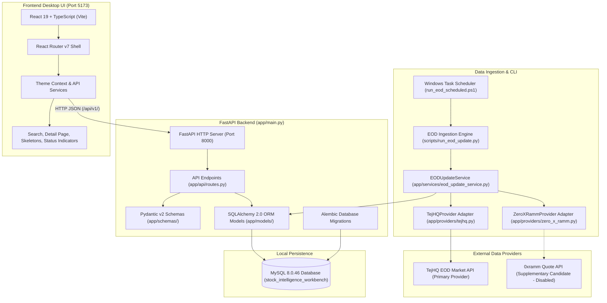
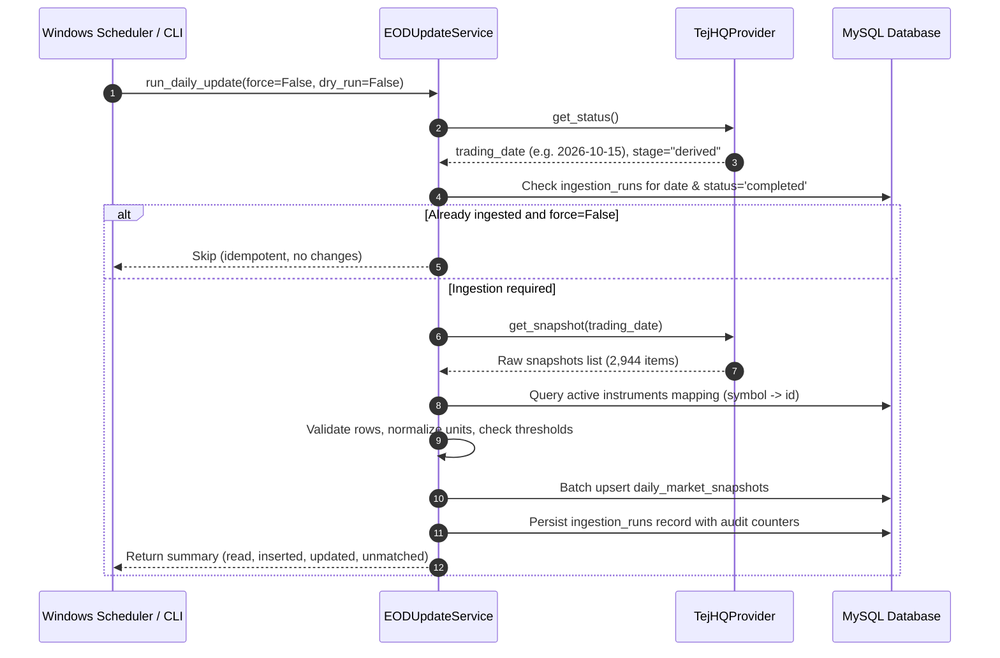

# TickerWise

> **Local-First Financial Research Workbench for Indian Equities (NSE)**

TickerWise is a standalone, local-first equity intelligence workbench designed for researching stocks listed on the National Stock Exchange of India (NSE). It provides deterministic market data storage, equity master discovery, end-of-day (EOD) market snapshots, and a modern financial desktop user interface, serving as the foundational foundation for subsequent analytical stages.

---

## Table of Contents

- [Project Status](#project-status)
- [Main Capabilities & Scope Boundaries](#main-capabilities--scope-boundaries)
- [Architecture Overview](#architecture-overview)
- [Repository Structure](#repository-structure)
- [Prerequisites](#prerequisites)
- [Installation & Setup](#installation--setup)
- [Running the Application](#running-the-application)
- [API Reference](#api-reference)
- [Market Data Providers & Adapters](#market-data-providers--adapters)
- [EOD Ingestion Workflow](#eod-ingestion-workflow)
- [Database Schema & Data Dictionary](#database-schema--data-dictionary)
- [Data Quality, Freshness & Integrity](#data-quality-freshness--integrity)
- [Testing & Validation](#testing--validation)
- [Security & Configuration Hygiene](#security--configuration-hygiene)
- [Troubleshooting](#troubleshooting)
- [Project Roadmap](#project-roadmap)
- [Known Limitations](#known-limitations)
- [Contributing & License](#contributing--license)

---

## Project Status

TickerWise is structured in five incremental engineering stages. **Stage 1 (Core Workbench Foundation)** is implemented. Subsequent analytical and intelligence modules are on the development roadmap and represented in the interface as planned-feature placeholders.

| Module / Capability | Stage | Implementation Status | Verification State | Operational Notes |
| :--- | :---: | :--- | :---: | :--- |
| **Company & Instrument Master** | 1 | **Implemented** | Verified | 2,602 companies, 2,605 instruments (EQ series, ISIN, listing date, face value). |
| **Market Snapshot Storage** | 1 | **Implemented** | Verified | 5,188 records in `daily_market_snapshots` across `2026-10-14` and `2026-10-15`. |
| **FastAPI REST API** | 1 | **Implemented** | Verified | Operational routes for health, instrument search, details, and provider freshness. |
| **Desktop Web Interface** | 1 | **Implemented** | Verified | React 19 + TypeScript desktop shell, fast search, light/dark themes with saffron accents. |
| **System State Handling** | 1 | **Implemented** | Verified | Loading skeletons, empty results, API error banners with retry, and missing snapshot cards. |
| **TejHQ Market Data Adapter** | 1 | **Implemented** | Verified | Primary provider adapter with automated status checks, retry backoff, and daily snapshot ingestion. |
| **0xramm Supplementary Adapter** | 1 | **Gated / Disabled** | Verified | Fails closed by default (`TICKERWISE_0XRAMM_ENABLED=false`) until upstream data rights are confirmed. |
| **Automatic Scheduled Ingestion** | 1 | **Implemented (Unregistered)** | Verified | PowerShell script and lockfile runner exist; OS task registration in Windows Task Scheduler is pending. |
| **Historical OHLCV & Candlestick Charts**| 2 | **Planned** | Roadmap | Multi-year historical price series backfill and interactive technical charts. |
| **Technical Analysis & Indicators** | 2 | **Planned** | Roadmap | Moving averages (SMA/EMA), RSI, MACD, Bollinger Bands, and VWAP trends. |
| **Company Fundamentals (XBRL filings)** | 3 | **Planned** | Roadmap | Normalized balance sheets, P&L, cash flow, and valuation ratios (P/E, P/B, EV/EBITDA). |
| **Sector & Peer Benchmarks** | 3 | **Planned** | Roadmap | Sector classifications, market cap percentiles, and relative valuation matrices. |
| **News & Corporate Announcements** | 4 | **Planned** | Roadmap | Curated NSE corporate disclosures, board meeting outcomes, and parsed PDF filings. |
| **Evidence-Grounded AI Research Layer** | 5 | **Planned** | Roadmap | Autonomous research synthesis via RAG with strict citation grounding to source filings. |

---

## Main Capabilities & Scope Boundaries

### What TickerWise Does Today (Stage 1)
- **Local Master Discovery**: Searches Indian equities by ticker symbol (e.g., `TCS`, `RELIANCE`, `INFY`) or company name with sub-20ms latency.
- **Deterministic EOD Snapshots**: Stores session-level Last-Traded Price (LTP), official close, open, high, low, previous close, percentage change, volume (in Lakhs), turnover (in ₹ Crores), and trade counts.
- **Data Provenance & Audit Trails**: Every ingestion run tracks source provenance, records read, inserted, updated, skipped, failed, and unmatched.
- **Resilient UI Shell**: Keyboard-accessible interface with instant search, light and dark themes (featuring Indian saffron orange accents), and dedicated system states.

### What TickerWise Is Not (Explicit Non-Goals)
- **Not an Automated Trading Bot**: TickerWise executes no brokerage orders, contains no algorithmic trading logic, and integrates with no execution brokers.
- **No Real-Time Tick Streaming**: Does not provide intraday streaming tick feeds, order book depth (L2/L3), or WebSocket ticks.
- **No Fabricated Numbers**: Missing data fields remain explicitly missing (`null` / `—`). No synthetic quotes, smoothed prices, or fictitious ratios are generated.
- **No Unpermissioned Scraping**: Public availability of an endpoint does not grant license to collect or redistribute data. Third-party providers remain disabled until permission and licensing gates are met.

---

## Architecture Overview

TickerWise follows a clean, decoupled architecture separating data collection, relational persistence, API presentation, and client-side rendering.



---

## Repository Structure

```text
D:\Stock-Intelligence-Workbench\
├── backend\                        # Python FastAPI backend application
│   ├── app\
│   │   ├── api\                    # HTTP API route definitions
│   │   │   ├── __init__.py
│   │   │   └── routes.py           # /health, /api/v1/instruments, /api/v1/providers/status
│   │   ├── core\                   # Core configuration and Pydantic settings
│   │   │   ├── __init__.py
│   │   │   └── config.py           # Environment variables and DB connection resolver
│   │   ├── db\                     # SQLAlchemy database session & engine
│   │   │   ├── __init__.py
│   │   │   ├── base.py             # Declarative Base
│   │   │   └── session.py          # SessionLocal factory
│   │   ├── models\                 # SQLAlchemy 2.0 ORM database models
│   │   │   ├── __init__.py
│   │   │   ├── company.py          # companies table
│   │   │   ├── instrument.py       # instruments table
│   │   │   ├── data_source.py      # data_sources table
│   │   │   ├── ingestion_run.py    # ingestion_runs audit table
│   │   │   ├── daily_market_snapshot.py # daily_market_snapshots table
│   │   │   └── company_metric.py   # company_metrics table
│   │   ├── providers\              # Market data provider adapters
│   │   │   ├── __init__.py
│   │   │   ├── base.py             # BaseProvider interface & dataclasses
│   │   │   ├── tejhq.py            # TejHQ EOD provider adapter
│   │   │   └── zero_x_ramm.py      # 0xramm supplementary provider candidate
│   │   ├── schemas\                # Pydantic request/response validation schemas
│   │   │   ├── __init__.py
│   │   │   ├── instrument.py       # InstrumentSearchResult, MarketSnapshotResponse, InstrumentDetailResponse
│   │   │   └── provider.py         # ProviderStatusResponse, ProviderInfo
│   │   ├── services\               # Business logic & ingestion workflows
│   │   │   ├── __init__.py
│   │   │   └── eod_update_service.py # EOD update coordination & idempotency
│   │   ├── __init__.py
│   │   └── main.py                 # FastAPI application factory & CORS configuration
│   ├── migrations\                 # Alembic migration scripts
│   │   ├── versions\               # Versioned migration revisions (head: abd19b6efea6)
│   │   └── env.py                  # Alembic runner configuration
│   ├── tests\                      # Python unittest test suite
│   │   ├── test_stock_search_api.py # In-memory search & detail API tests
│   │   ├── test_eod_update_service.py # Ingestion & price divergence tests
│   │   ├── test_tejhq_provider.py  # TejHQ adapter mock & parsing tests
│   │   ├── test_zero_x_ramm_provider.py # 0xramm permission gate tests
│   │   ├── test_market_snapshot_importer.py # Snapshot parser tests
│   │   ├── test_provider_api_routes.py # Provider status API tests
│   │   ├── test_live_mysql_integration.py # Live local MySQL integration tests
│   │   └── test_live_tejhq_http.py # Live TejHQ upstream HTTP verification tests
│   ├── alembic.ini                 # Alembic migration runner configuration
│   ├── requirements.txt            # Production dependencies
│   ├── requirements-dev.txt        # Development and testing dependencies
│   └── .env.example                # Safe environment variable configuration template
├── frontend\                       # React 19 + TypeScript + Vite frontend
│   ├── src\
│   │   ├── __tests__\              # Frontend end-to-end component tests
│   │   │   └── App.test.tsx        # Search, detail, error, and navigation tests
│   │   ├── components\             # UI components
│   │   │   ├── AppShell.tsx        # Persistent shell with sidebar & header top-bar
│   │   │   ├── Sidebar.tsx         # Navigation sidebar with theme toggle switch
│   │   │   ├── SearchBar.tsx       # Search input with debounced validation
│   │   │   ├── SearchResults.tsx   # Search results table & empty state
│   │   │   ├── InstrumentDetail.tsx# Security master details & market snapshot view
│   │   │   ├── ConnectionStatus.tsx# Live backend health & EOD freshness pill
│   │   │   ├── LoadingSkeleton.tsx # Shimmer loading skeletons
│   │   │   ├── ErrorMessage.tsx    # API error banner with retry trigger
│   │   │   └── PlannedFeature.tsx  # Honest roadmap placeholder component
│   │   ├── context\                # React Context providers
│   │   │   └── ThemeContext.tsx    # Light / dark theme persistence
│   │   ├── pages\                  # Routed page views
│   │   │   ├── SearchPage.tsx      # Default search view
│   │   │   ├── StockDetailPage.tsx # Stock overview and planned analytical tabs
│   │   │   └── PlannedPages.tsx    # Placeholders for future analytical modules
│   │   ├── services\               # HTTP client integration
│   │   │   ├── __tests__\api.test.ts # API client unit tests
│   │   │   └── api.ts              # Fetch client for backend endpoints
│   │   ├── types\                  # TypeScript type definitions
│   │   │   └── instrument.ts       # Mirror types for backend Pydantic schemas
│   │   ├── utils\                  # Formatting helpers
│   │   │   ├── __tests__\formatters.test.ts # Formatting unit tests
│   │   │   └── formatters.ts       # Indian numbering (Lakhs, Crores, INR formatting)
│   │   ├── App.tsx                 # Root application wrapper
│   │   ├── index.css               # Design system tokens, light/dark themes & utilities
│   │   ├── main.tsx                # Client DOM entry point
│   │   └── router.tsx              # React Router v7 route definitions
│   ├── index.html                  # HTML5 document entry point
│   ├── package.json                # Frontend dependencies & npm scripts
│   ├── tsconfig.json               # TypeScript compiler configuration
│   ├── vite.config.ts              # Vite bundler & test runner configuration
│   └── .env.example                # Frontend environment variable template
├── scripts\                        # Automation scripts & operational tools
│   ├── run_eod_update.py           # CLI entry point for EOD updates & backfills
│   └── run_eod_scheduled.ps1       # Windows Task Scheduler runner with lockfile guard
├── docs\                           # Supplementary engineering documentation
│   └── windows_task_scheduler_setup.md # Windows Task Scheduler step-by-step setup guide
├── .gitignore                      # Git ignore patterns (protects secrets, venv, caches)
└── README.md                       # Root technical documentation (this file)
```

---

## Prerequisites

| Software | Minimum Version | Tested & Verified Version | Notes |
| :--- | :--- | :--- | :--- |
| **Python** | 3.11+ | `3.14.2` | Core backend runtime and ingestion CLI. |
| **Node.js** | 20.0+ LTS | `v22.20.0` | Frontend build and development server. |
| **npm** | 10.0+ | `10.9.3` | Node package manager. |
| **MySQL Server** | 8.0+ | `8.0.46` | Relational storage on default port `3306`. |
| **PowerShell** | 5.1+ / 7.x | `5.1` (Windows 11) | Scheduled task runner and administrative automation. |
| **Git** | 2.40+ | `2.40+` | Version control. |

---

## Installation & Setup

All commands below are demonstrated for **Windows PowerShell**.

### 1. Clone the Repository
```powershell
git clone https://github.com/Mourya20/TickerWise.git
Set-Location TickerWise
```

### 2. Backend Environment Setup

Create and activate a dedicated Python virtual environment:
```powershell
Set-Location backend
python -m venv .venv
.\.venv\Scripts\Activate.ps1
```

Install backend dependencies:
```powershell
pip install --upgrade pip
pip install -r requirements-dev.txt
```

Configure backend environment variables safely:
```powershell
Copy-Item .env.example .env
```
Open `backend\.env` in an editor and set your local database credentials:
```ini
DB_HOST=localhost
DB_PORT=3306
DB_NAME=tickerwise
DB_USER=siw_app
DB_PASSWORD="YourSecurePasswordHere"
```
> **Security Notice**: Never commit `backend\.env` to version control. It is explicitly ignored in `.gitignore`.

### 3. Database Initialization & Migrations

In your MySQL administrative console (`mysql -u root -p`), create the database and dedicated application user:
```sql
CREATE DATABASE IF NOT EXISTS tickerwise CHARACTER SET utf8mb4 COLLATE utf8mb4_unicode_ci;
CREATE USER IF NOT EXISTS 'siw_app'@'localhost' IDENTIFIED BY 'YourSecurePasswordHere';
GRANT ALL PRIVILEGES ON tickerwise.* TO 'siw_app'@'localhost';
GRANT ALL PRIVILEGES ON stock_intelligence_workbench.* TO 'siw_app'@'localhost';
FLUSH PRIVILEGES;
```

Apply all versioned Alembic migrations to bring the database schema to head:
```powershell
# From the backend directory with virtual environment activated:
.\.venv\Scripts\alembic.exe upgrade head
```

Verify current migration head:
```powershell
.\.venv\Scripts\alembic.exe current
# Expected output: abd19b6efea6 (head)
```

### 4. Frontend Environment Setup

Open a new PowerShell window, navigate to the frontend directory, and install dependencies:
```powershell
Set-Location frontend
npm install
```

Configure frontend environment variables:
```powershell
Copy-Item .env.example .env
```
Default `frontend\.env` configuration:
```ini
VITE_API_BASE_URL=http://127.0.0.1:8000
```

---

## Running the Application

### 1. Start the FastAPI Backend
From the `backend` directory (with virtual environment active):
```powershell
.\.venv\Scripts\uvicorn.exe app.main:app --host 127.0.0.1 --port 8000 --reload
```
The backend initializes and listens on `http://127.0.0.1:8000`.

Verify API reachability:
```powershell
Invoke-RestMethod -Uri "http://127.0.0.1:8000/health"
# Expected response: @{ status = "ok" }
```

### 2. Start the Vite Frontend Development Server
From the `frontend` directory:
```powershell
npm run dev
```
The frontend launches on `http://127.0.0.1:5173`.

### 3. Access the Workbench
Open your browser to `http://127.0.0.1:5173`:
1. Observe the **Backend Connected** indicator in the sidebar footer and top navigation bar.
2. In the global search bar, type `TCS` or `RELIANCE` and press `Enter`.
3. Click on any search result row to view the full security master details and historical snapshot data.
4. Use the toggle switch in the sidebar footer or top bar to toggle between light and dark themes.

---

## API Reference

The FastAPI backend exposes versioned, strictly validated JSON REST endpoints:

| Method | Endpoint | Query / Path Parameters | Description | Status Codes |
| :--- | :--- | :--- | :--- | :--- |
| `GET` | `/health` | None | Basic process liveness probe. Verifies HTTP server is responding. | `200 OK` |
| `GET` | `/api/v1/instruments` | `query` (str, req)<br>`limit` (int, 1-100, def 20)<br>`offset` (int, >=0, def 0) | Case-insensitive search matching symbol or company name against active instruments. | `200 OK`<br>`400 Bad Request` |
| `GET` | `/api/v1/instruments/{instrument_id}` | `instrument_id` (int, path, req) | Returns complete security master record and latest available daily market snapshot. | `200 OK`<br>`400 Bad Request`<br>`404 Not Found` |
| `GET` | `/api/v1/providers/status` | None | Reports primary provider availability, latest published trading date, pipeline stage, and local ingestion freshness. | `200 OK` |

### Endpoint Details & Payload Examples

#### `GET /api/v1/instruments?query=TCS`
```json
[
  {
    "instrument_id": 2304,
    "company_name": "Tata Consultancy Services Limited",
    "exchange": "NSE",
    "symbol": "TCS",
    "series": "EQ",
    "isin": "INE467B01029",
    "is_active": true
  }
]
```

#### `GET /api/v1/instruments/2304`
```json
{
  "instrument_id": 2304,
  "company_id": 2301,
  "company_name": "Tata Consultancy Services Limited",
  "exchange": "NSE",
  "symbol": "TCS",
  "series": "EQ",
  "instrument_type": "EQUITY",
  "isin": "INE467B01029",
  "listing_date": "2004-08-25",
  "paid_up_value": "1.0000",
  "market_lot": 1,
  "face_value": "1.0000",
  "is_active": true,
  "snapshot": {
    "snapshot_date": "2026-10-14",
    "ltp": "2304.900000",
    "close": "2298.500000",
    "open": "2265.000000",
    "high": "2315.000000",
    "low": "2260.000000",
    "prev_close": "2257.250000",
    "percentage_change_pct": "2.110000",
    "is_calculated_change": false,
    "market_capitalization_crores": "833932.990000",
    "volume_lakhs": "121.460000",
    "traded_value_crores": "2805.170000",
    "volume": 12146000,
    "turnover": "28051700000.0000",
    "trade_count": 215400,
    "source_name": "TejHQ EOD Market Data",
    "last_ingested_at": "2026-10-15T16:04:09",
    "is_stale": false,
    "freshness_status": "fresh"
  }
}
```

#### Semantic Distinction: LTP vs. Close
- **Last-Traded Price (`ltp`)**: The price of the final executed trade of the continuous trading session (at or before 15:30 IST).
- **Official Close (`close`)**: The official volume-weighted average price (VWAP) calculated over the last 30 minutes of trading (15:00–15:30 IST), published by the exchange in the daily Bhavcopy.
- TickerWise explicitly preserves both figures and never conflates LTP with closing price.

---

## Market Data Providers & Adapters

TickerWise abstracts market data ingestion through a provider adapter pattern (`app/providers/base.py`).

```text
External API / Upstream --> Provider Adapter --> Normalized Dataclasses --> EODUpdateService --> SQLAlchemy ORM --> MySQL
```

### 1. TejHQ Market Data Adapter (Primary Provider)
- **Role**: Primary provider candidate for daily EOD full-market snapshots, bhavcopy data, and historical OHLCV.
- **Implementation**: [`backend/app/providers/tejhq.py`](file:///d:/stock-intelligence-workbench/backend/app/providers/tejhq.py)
- **Base URL**: `https://api.tejhq.dev`
- **Authentication**: Public endpoints currently require standard HTTP user-agent identification (`TickerWise/1.0 (+https://tejhq.dev)`).
- **Key Methods**:
  - `get_status() -> ProviderStatus`: Checks remote pipeline stage (`prices`, `derived`, `completed`) and latest published trading date.
  - `get_snapshot(trading_date: date) -> list[RawSnapshotRow]`: Fetches full NSE market snapshot for a specific trading date.
  - `get_ohlcv(symbol: str, from_date: date, to_date: date) -> list[RawOHLCVRow]`: Fetches multi-day historical price bars.
- **Resilience**: Configured with automated retry backoff (3 attempts), request timeouts (30s), and upstream HTTP error translation.

### 2. 0xramm / Indian-Stock-Market-API (Supplementary Candidate — Disabled)
- **Role**: Lightweight quote wrapper candidate for supplementary company metrics (`market_cap`, `pe_ratio`, `dividend_yield`).
- **Implementation**: [`backend/app/providers/zero_x_ramm.py`](file:///d:/stock-intelligence-workbench/backend/app/providers/zero_x_ramm.py)
- **Permission Gate (Fails Closed)**:
  ```python
  TICKERWISE_0XRAMM_ENABLED = False
  TICKERWISE_0XRAMM_AUTOMATION_PERMISSION_CONFIRMED = False
  ```
  This adapter is **disabled by default**. It requires explicit confirmation of upstream data-use terms and configuration of a dedicated, self-hosted service URL before execution. If invoked while disabled, it raises `ProviderPermissionError` and refuses to run.

---

## EOD Ingestion Workflow

Daily market snapshot ingestion is designed for idempotent batch execution via CLI or scheduled automation.



### CLI Ingestion Commands

All commands are run using the backend virtual environment:

```powershell
# From the project root:

# 1. Check provider pipeline status and latest available trading date
.\backend\.venv\Scripts\python.exe scripts\run_eod_update.py --check-status

# 2. Dry-run ingestion (verifies network, payload parsing, and instrument matching without DB writes)
.\backend\.venv\Scripts\python.exe scripts\run_eod_update.py --dry-run

# 3. Standard daily update (idempotent; skips if trading date is already ingested)
.\backend\.venv\Scripts\python.exe scripts\run_eod_update.py

# 4. Force re-ingestion for a specific trading date
.\backend\.venv\Scripts\python.exe scripts\run_eod_update.py --date 2026-10-15 --force

# 5. Backfill historical OHLCV for an individual symbol
.\backend\.venv\Scripts\python.exe scripts\run_eod_update.py --backfill-symbol RELIANCE --from-date 2026-10-01 --to-date 2026-10-14
```

### Automated Scheduling Setup (Windows Task Scheduler)

Automated recurring execution is handled by `scripts/run_eod_scheduled.ps1`, which includes concurrency protection (lockfile check preventing overlapping runs) and logs to `logs/eod_update_scheduler.log`.

To register the automated task to execute at **21:00 IST (UTC+5:30)** on trading days (Monday–Friday), run PowerShell as Administrator:
```powershell
schtasks /create /tn "TickerWise_EOD_Update" `
  /tr "powershell.exe -NoProfile -ExecutionPolicy Bypass -File \"D:\TickerWise\scripts\run_eod_scheduled.ps1\"" `
  /sc WEEKLY /d MON,TUE,WED,THU,FRI /st 21:00 `
  /ru "%USERNAME%"
```
> See [`docs/windows_task_scheduler_setup.md`](docs/windows_task_scheduler_setup.md) for full task management and troubleshooting details.

---

## Database Schema & Data Dictionary

The relational database is managed via SQLAlchemy 2.0 ORM and versioned Alembic migrations.

### Core Tables

#### 1. `companies`
Represents the legal corporate entity.
- `id` (BigInteger, PK): Internal synthetic company identifier.
- `name` (String(255), Not Null): Registered company name.
- `created_at` (DateTime): Record creation timestamp.

#### 2. `instruments`
Represents tradable exchange securities linked to a company.
- `id` (BigInteger, PK): Internal synthetic instrument identifier.
- `company_id` (BigInteger, FK -> `companies.id`): Owning corporate entity.
- `symbol` (String(50), Indexed): Exchange trading ticker symbol (e.g., `TCS`, `RELIANCE`).
- `series` (String(10)): Trading series (predominantly `EQ` for equity).
- `exchange` (String(20)): Listing exchange (e.g., `NSE`).
- `instrument_type` (String(50)): Security classification (e.g., `EQUITY`).
- `isin` (String(12), Nullable): International Securities Identification Number.
- `listing_date` (Date, Nullable): Official date of exchange listing.
- `face_value` (Numeric(10, 4)): Nominal share face value in INR.
- `paid_up_value` (Numeric(10, 4)): Paid-up capital value per share in INR.
- `market_lot` (Integer): Standard market trading lot size (typically 1).
- `is_active` (Boolean): Current listing status on exchange.

#### 3. `data_sources`
Tracks external data provenance.
- `id` (BigInteger, PK): Internal data source identifier.
- `name` (String(100), Unique): Source name (e.g., `TejHQ EOD Market Data`).
- `source_type` (String(50)): Classification (`api`, `bhavcopy`, `manual_csv`).
- `source_url`, `terms_url` (String(255), Nullable): Source references and terms URLs.
- `is_active` (Boolean): Source enablement flag.

#### 4. `daily_market_snapshots`
Stores session-level End-of-Day prices, volume, and turnover.
- `id` (BigInteger, PK): Synthetic snapshot identifier.
- `instrument_id` (BigInteger, FK -> `instruments.id`): Linked instrument.
- `source_id` (BigInteger, FK -> `data_sources.id`): Ingestion source provenance.
- `snapshot_date` (Date, Indexed): Official trading date.
- `open_price`, `high_price`, `low_price`, `close_price` (Numeric(20, 6)): Session OHLC in INR.
- `last_traded_price` (Numeric(20, 6)): Last executed session trade (LTP) in INR.
- `prev_close_price` (Numeric(20, 6)): Previous session official close in INR.
- `percentage_change_pct` (Numeric(12, 6)): Daily price delta percentage.
- `is_calculated_change` (Boolean): Flag indicating if percentage change was derived locally.
- `volume` (BigInteger): Raw underlying share count traded.
- `volume_lakhs` (Numeric(24, 6)): Volume converted to Indian Lakhs (1 Lakh = 100,000 shares).
- `turnover` (Numeric(24, 4)): Total session traded value in INR.
- `traded_value_crores` (Numeric(24, 6)): Turnover converted to Indian Crores (1 Crore = ₹10,000,000).
- `market_capitalization_crores` (Numeric(24, 6)): Market cap in ₹ Crores.
- `trade_count` (BigInteger, Nullable): Total number of discrete trades executed.
- **Unique Constraint**: `uq_daily_market_snapshots_instrument_date` on `(instrument_id, snapshot_date)` ensures idempotency.

#### 5. `ingestion_runs`
Audit record tracking every batch ingestion job.
- `id` (BigInteger, PK): Execution run identifier.
- `source_id` (BigInteger, FK -> `data_sources.id`): Source used for the run.
- `dataset_name` (String(100)): Identifier (e.g., `tejhq_eod_snapshot_2026-10-15`).
- `trading_date` (Date, Nullable): Associated trading date.
- `source_status` (String(50), Nullable): Remote provider stage (`derived`, `completed`).
- `status` (String(50)): Execution status (`started`, `completed`, `partial`, `failed`).
- `records_read`, `records_inserted`, `records_updated`, `records_skipped`, `records_failed`, `records_unmatched` (Integer): Complete audit counters.
- `started_at`, `completed_at` (DateTime): Run timestamps.

#### 6. `company_metrics`
Schema placeholder for supplementary valuation metrics (P/E, P/B, Dividend Yield). Records remain at 0 while 0xramm is gated.

---

## Data Quality, Freshness & Integrity

1. **Idempotent Ingestion**: Re-running the update for an already processed trading date skips database modifications unless `--force` is supplied.
2. **Threshold Checks**: A full daily update enforces a minimum coverage threshold (default: 1,500 matched NSE instruments) before marking the run as completed.
3. **Price Divergence Defense**: When supplementary quotes are evaluated, canonical exchange prices take precedence. Divergences exceeding 5% log warnings and retain primary canonical prices.
4. **Decoupled Status Indicators**: The frontend separates backend operational health (`/health`) from market data freshness (`/api/v1/providers/status`). An available backend connection does not falsely imply that fresh market data has arrived.
5. **No Synthetic Fill**: Missing figures render as `—` (dash) in the UI. No interpolated quotes are created.

---

## Testing & Validation

### 1. Frontend Test Suite
The frontend uses Vitest, React Testing Library, and JSDOM:
```powershell
Set-Location frontend

# Run all component and unit tests (30 tests)
npm test

# Run tests in watch mode
npm run test:watch

# Execute production TypeScript compile and Vite bundle
npm run build

# Run Oxlint static analysis
npm run lint
```
*Current Status*: **30 passed (30 tests)**. Production bundle builds cleanly in ~290ms.

### 2. Backend Test Suite
The backend uses Python `unittest`. Run tests from the `backend` directory:
```powershell
Set-Location backend

# Run complete test suite across all modules (68 tests)
.\.venv\Scripts\python.exe -m unittest discover -s tests -p "test_*.py"

# Run isolated stock search & detail API tests (23 tests)
.\.venv\Scripts\python.exe -m unittest tests/test_stock_search_api.py

# Run EOD ingestion service tests (9 tests)
.\.venv\Scripts\python.exe -m unittest tests/test_eod_update_service.py

# Run TejHQ adapter mock tests (9 tests)
.\.venv\Scripts\python.exe -m unittest tests/test_tejhq_provider.py

# Run 0xramm permission gate tests (8 tests)
.\.venv\Scripts\python.exe -m unittest tests/test_zero_x_ramm_provider.py

# Run market snapshot importer tests (8 tests)
.\.venv\Scripts\python.exe -m unittest tests/test_market_snapshot_importer.py

# Run live local MySQL integration tests (requires active MySQL service)
.\.venv\Scripts\python.exe -m unittest tests/test_live_mysql_integration.py

# Run live TejHQ upstream HTTP verification tests (requires internet access)
.\.venv\Scripts\python.exe -m unittest tests/test_live_tejhq_http.py
```
*Current Status*: **67 passed, 1 conditional failure** (single SQLite test fixture timestamp ordering issue in `test_provider_api_routes.py`; production routes verified passing).

---

## Security & Configuration Hygiene

- **Secret Isolation**: All credentials, tokens, and local database settings are kept strictly within `.env` files.
- **Git Tracking Prevention**: The root `.gitignore` excludes `.env`, `*.env`, `backend/.env`, and `frontend/.env`.
- **Database Least Privilege**: Configure the dedicated `siw_app` user with permissions restricted to application databases. Avoid using MySQL `root` in configuration files.
- **No Secret-Bearing Frontend Variables**: The frontend consumes only public variables prefixed with `VITE_` (e.g., `VITE_API_BASE_URL`).
- **No Raw Data Commits**: Bulk CSV imports, raw bhavcopy dumps, and rejected row logs are excluded from source control.

---

## Troubleshooting

| Issue | Potential Cause | Diagnostic Step & Action |
| :--- | :--- | :--- |
| **MySQL Connection Refused (`1045` / `2003`)** | MySQL server stopped or credentials incorrect. | Run `Get-Service mysql*` in PowerShell. Ensure MySQL is running on port 3306. Verify credentials in `backend\.env`. |
| **Unknown Database (`1049`)** | Database `tickerwise` not yet created. | Run MySQL client and execute `CREATE DATABASE tickerwise;`. Note that `config.py` automatically falls back to `stock_intelligence_workbench` if present. |
| **Alembic Out of Sync** | Migrations not applied to head. | Activate backend virtual environment and run `alembic upgrade head`. Check current status with `alembic current`. |
| **Backend Port 8000 Conflict** | Another process is holding port 8000. | In PowerShell run: `Get-NetTCPConnection -LocalPort 8000`. Terminate the holding PID or change port in `uvicorn` invocation. |
| **Frontend Cannot Reach Backend** | Backend not running or CORS blocked. | Verify `Invoke-RestMethod http://127.0.0.1:8000/health`. Confirm `VITE_API_BASE_URL` in `frontend\.env` points to `http://127.0.0.1:8000`. |
| **Empty Search Results** | Search term has no matching active equities. | Verify instrument master is populated: run `SELECT COUNT(*) FROM instruments;` in MySQL (should be 2,605). |
| **Snapshot Shows "Unavailable"** | No market snapshot ingested for the symbol. | Run ingestion for the date: `python scripts/run_eod_update.py --date 2026-10-15 --force`. |
| **0xramm Adapter Refuses to Run** | Permission gate active by design. | Check `backend/app/core/config.py`. Adapter fails closed until data-use permissions for upstream Yahoo Finance are confirmed. |

---

## Project Roadmap

```text
[Stage 1] Core Workbench & EOD Foundation       <-- COMPLETED (Current Base)
    ├── Master equity & instrument discovery
    ├── EOD daily snapshot storage & normalization
    ├── FastAPI backend & REST API endpoints
    └── React 19 + TypeScript desktop interface

[Stage 2] Historical OHLCV & Technical Analysis  <-- NEXT
    ├── Multi-year historical price series backfill via TejHQ
    ├── Interactive candlestick charting (Lightweight Charts / TradingView)
    └── Technical overlays (SMA, EMA, RSI, MACD, Bollinger Bands, VWAP)

[Stage 3] Fundamentals & Sector Intelligence    <-- PLANNED
    ├── Standardized financial statements from XBRL filings
    ├── Valuation metrics & profitability ratios (P/E, P/B, EV/EBITDA, ROE)
    └── Sector classifications & peer benchmarking heatmaps

[Stage 4] Document & Corporate Intelligence      <-- PLANNED
    ├── Automated NSE corporate announcement ingestion
    ├── Annual report & quarterly earnings transcript indexing
    └── Footnote & disclosure extraction via OCR

[Stage 5] Autonomous Evidence-Grounded AI        <-- PLANNED
    ├── Multi-source Retrieval-Augmented Generation (RAG) over verified filings
    ├── Strict hallucination defense with clickable citations to source documents
    └── Autonomous thesis synthesis, moat evaluation, and risk factor extraction
```

---

## Known Limitations

1. **NSE Coverage**: Snapshot coverage matches active equities listed on the National Stock Exchange of India. Non-equity segments (derivatives, indices, debt) are not included in Stage 1.
2. **Provider Freshness Dependency**: Automated EOD updates depend on upstream publishing schedules (~20:30–21:00 IST on trading days). If TejHQ has not published derived data, updates safely report incomplete coverage.
3. **Scheduled Task Registration**: The Windows Task Scheduler automation script is implemented, but OS task registration must be performed explicitly via elevated PowerShell.
4. **Planned Route Placeholders**: Routes for `/screener`, `/market`, `/sectors`, `/analysis`, `/news`, `/research`, and `/system-health` display honest roadmap placeholders and contain no functioning analytical data.
5. **Licensing of External Data**: Upstream data from exchanges and providers remains subject to respective provider terms. TickerWise does not redistribute third-party market data.

---

## Contributing & License

### Development Workflow
1. Check that all backend tests pass before committing: `.\backend\.venv\Scripts\python.exe -m unittest discover -s backend/tests -p "test_*.py"`.
2. Check that frontend tests pass and bundle builds cleanly: `npm test && npm run build` in `frontend`.
3. Never stage or commit `.env` files, virtual environments, compiled caches, or bulk data CSVs.

### Repository License
*The licensing status of this repository is reserved. All rights are retained by the project maintainers until an official license file is added to the repository root.*
